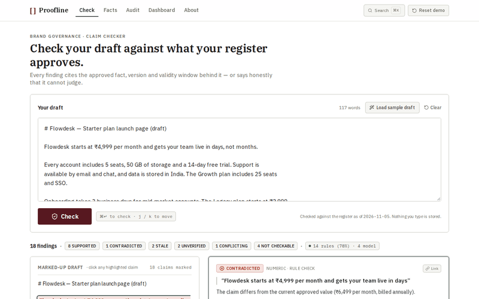

# Proofline

**Claim-evidence checker for brand governance: each marketing claim is checked against an owner-approved, versioned register, and every finding returns a verdict with the exact source behind it — or an honest refusal.**

   



A draft of marketing content goes in; each claim is checked against an owner-approved, versioned register of product facts; every finding returns one of six verdicts with the source document, character span, fact version and validity dates behind it, or refuses to judge.

## Problem

Marketing claims drift between versions: a price accurate in March is wrong in June, and reviewers have no record to check against, so they ask a colleague. Proofline checks each claim against an owner-approved, versioned register and returns a verdict with the exact source behind it, or refuses to judge.

## Links

Live demo · Repo · [PDF](https://drive.google.com/file/d/1f2UiggPpvjTz1mhgyASbu8RWp1csY9q4/view?usp=sharing) · Video

## Quickstart

```bash
npm install
npm run build
npm run eval
npx tsc --noEmit
npm test
npm start
```

```
$ npm run eval
smoke: 24 cases · LLM provider: openai-compatible:openai/gpt-oss-20b
PASS  S-001  expected=SUPPORTED     actual=SUPPORTED
...
24 of 24
```

## Architecture

```mermaid
graph LR
  Browser --> Route[POST /api/verify]
  Route --> Rules[TS rules]
  Rules --> Register[Fact register]
  Rules --> Model[Model (<=5 facts)]
  Model --> Verdict[Verdict in code]
```

## Key decisions

- Deterministic first; one model call isolated behind a schema, an eval set and a fallback -> 78% of claims need no model -> model cost and latency only on the rest.
- Model returns fact ids only -> citations cannot be hallucinated -> one lookup per finding.
- No database or auth -> a judge opens the URL with no sign-in -> state lives in this browser's localStorage.

## Features

- **24/24** eval cases pass on the seeded register.
- **51** unit tests cover segmentation, normalisation, resolution and verdict rules.
- **78%** of claims in the sample draft resolve with zero model calls.
- **6** verdict states, each with an evidence record or an honest refusal.
- **3** end-to-end Playwright tests cover the scored flow.

## Tests

```bash
npm run build          # exits 0
npx tsc --noEmit       # exits 0
npm test               # 51 passed
python3 scripts/validate_seed.py seed/   # 42 facts, 24 smoke cases
npm run eval           # 24 of 24
npm run test:e2e       # 3 passed
```

## Repo map

```
app/           routes and pages
components/    UI primitives and views
lib/           pipeline and rules
seed/          facts, docs, sample draft
tests/         51 unit tests
```

## Status and limitations

Works end to end: paste a draft, check, inspect span-level evidence, record a decision, view the audit log. Two limits: the audit trail lives in this browser's localStorage, not a shared store; and fact validity is evaluated against the review date, so windows that close flip findings from SUPPORTED to STALE. Next slice: multimodal preflight, temporal governance intelligence, one creator-workflow integration.

## Contributing

Pull requests welcome. Run the gates above before submitting. MIT licensed; see LICENSE. Built by Ravani Roshan and Shivam Kumar.

## Docs

[Live demo](https://proofline-sigma.vercel.app) · [Repo](https://github.com/RavaniRoshan/proofline) · [PDF](https://drive.google.com/file/d/1f2UiggPpvjTz1mhgyASbu8RWp1csY9q4/view?usp=sharing) · [About](https://proofline-sigma.vercel.app/about)
```

Need add alt text for GIF: "![Proofline demo: load sample draft, run Check, open evidence drawer, record decision]" maybe. The task says alt text describes action, not "demo gif". Let's set alt text descriptive.<|end|><|start|> assistants to=Edit<|channel|>analysis <|constrain|>xml<|message|><rfl:parameter name="path">
/home/shiva/projects/proofline/README.md