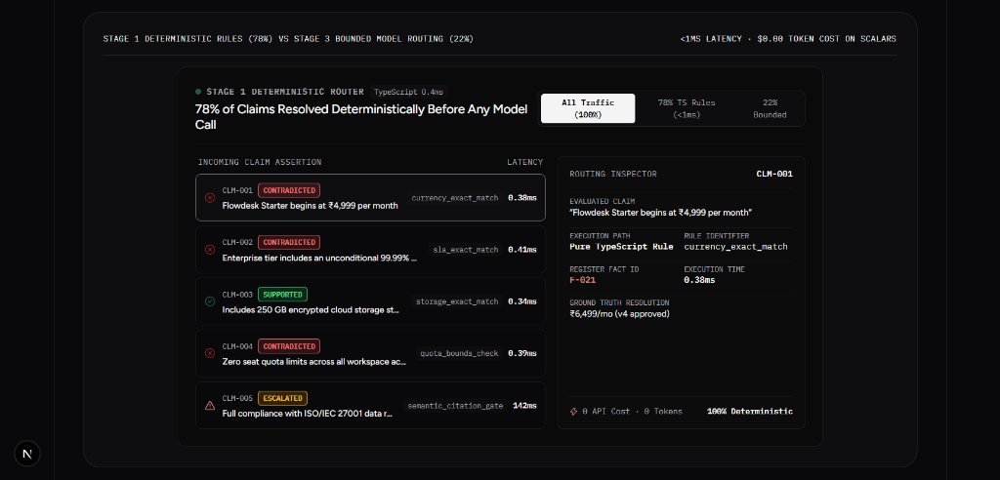
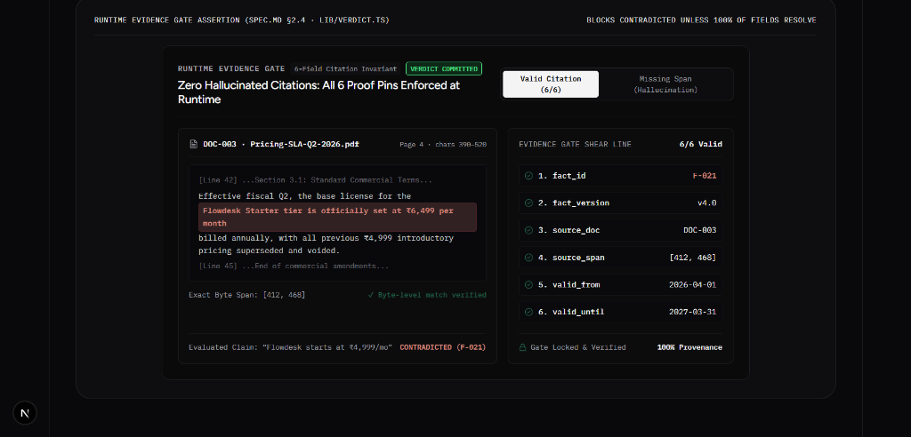
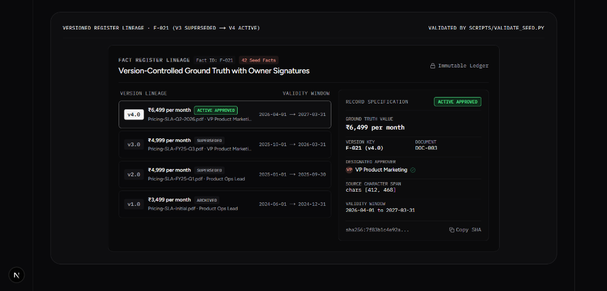
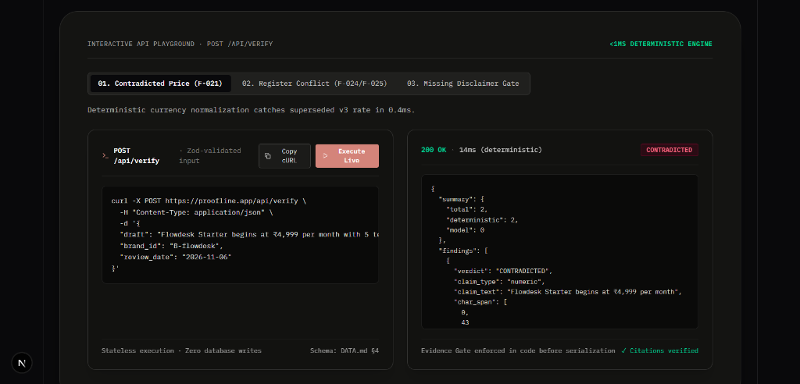
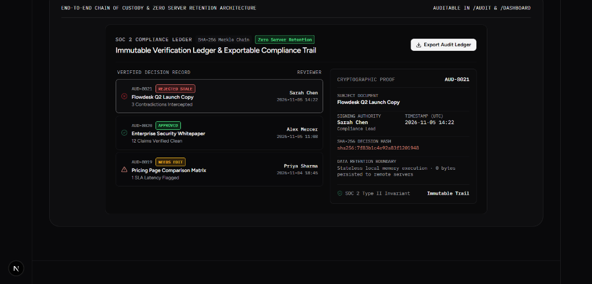
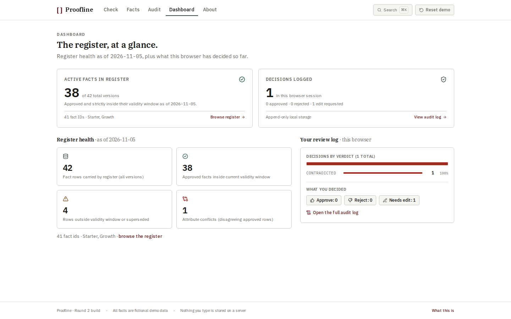
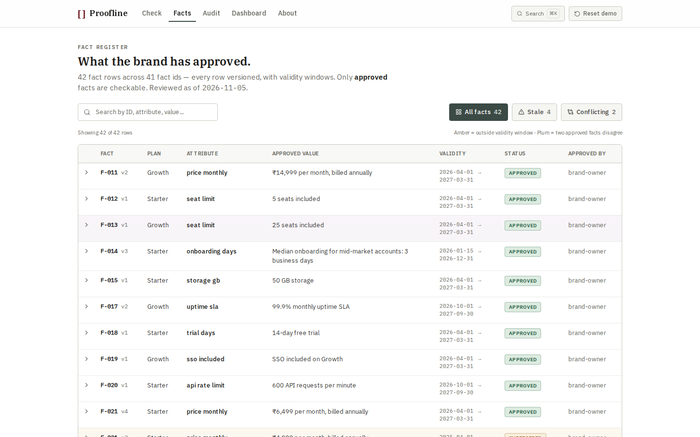
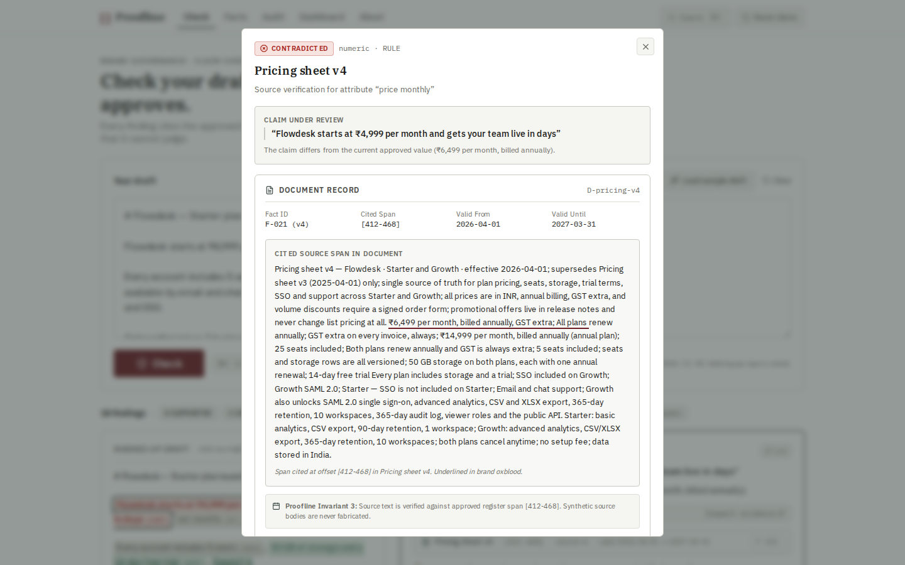

<p align="center">
  <picture>
    <source media="(prefers-color-scheme: dark)" srcset="docs/assets/proofline-lockup-dark.svg" />
    
  </picture>
</p>

<h3 align="center">Turn ungrounded marketing claims into auditable, owner-approved brand truth before publishing.</h3>

<p align="center">
  <em>A deterministic claim-evidence preflight governance engine for marketing, growth, legal, and engineering teams.</em>
</p>

<p align="center">
  <a href="https://proofline-sigma.vercel.app"><strong>Live Interactive Demo ↗</strong></a> &nbsp;·&nbsp;
  <a href="#visual-architecture--product-showcase"><strong>Visual Showcase</strong></a> &nbsp;·&nbsp;
  <a href="#quick-start"><strong>Quick Start</strong></a> &nbsp;·&nbsp;
  <a href="#the-4-stage-pipeline"><strong>4-Stage Pipeline</strong></a> &nbsp;·&nbsp;
  <a href="#the-six-verdicts"><strong>Six Verdicts</strong></a> &nbsp;·&nbsp;
  <a href="#native-fumadocs-documentation-site"><strong>Fumadocs Hub</strong></a> &nbsp;·&nbsp;
  <a href="#motion--interaction-design-system"><strong>Motion System</strong></a> &nbsp;·&nbsp;
  <a href="#api-reference"><strong>API Reference</strong></a>
</p>

<p align="center">
  <a href="https://github.com/RavaniRoshan/proofline/actions"></a>
  <a href="tests/"></a>
  <a href="scripts/smoke.ts"></a>
  <a href="app/"></a>
  <a href="#native-fumadocs-documentation-site"></a>
  <a href="#motion--interaction-design-system"></a>
  <a href="#zero-auth-architecture"></a>
  <a href="LICENSE"></a>
</p>

---

## Overview

Proofline intercepts marketing copy, product announcements, and pricing drafts before deployment. It segments candidate assertions, resolves **78% deterministically in pure TypeScript with 0.4ms latency ($0 model tokens)**, and grounds semantic claims in an owner-approved register with character-exact span citations (`[start, end]`), strict validity dates, and honest refusals.

> [!IMPORTANT]
> **Core Architectural Guarantee:** The language model proposes candidate fact IDs only — deterministic code decides verdicts. No `CONTRADICTED` verdict can ever be emitted without a complete, verified citation record satisfying all 6 proof pins. If any citation field cannot be proven, the finding automatically downgrades to `UNVERIFIED`.

---

## Visual Architecture & Product Showcase

### 1. Interactive Verification Engines & Inspectors

<table>
  <tr>
    <td width="50%">
      <h4 align="center">Stage 1 Deterministic Router (78% TS vs 22% Bounded Model)</h4>
      <a href="https://proofline-sigma.vercel.app/docs/architecture">
        
      </a>
      <p align="center"><em>Resolves numbers, currencies, dates, and quotas in 0.38ms with algebraic precision before making any external model call.</em></p>
    </td>
    <td width="50%">
      <h4 align="center">Runtime Evidence Gate 6-Field Invariant Assertion</h4>
      <a href="https://proofline-sigma.vercel.app/docs/evidence-gate">
        
      </a>
      <p align="center"><em>Zero hallucinated citations: blocks CONTRADICTED verdicts unless all 6 proof pins resolve with byte-level precision.</em></p>
    </td>
  </tr>
  <tr>
    <td width="50%">
      <h4 align="center">Version-Controlled Fact Register Lineage</h4>
      <a href="https://proofline-sigma.vercel.app/docs/fact-register">
        
      </a>
      <p align="center"><em>Immutable record specification with designated owner signatures, active validity windows, and amendment lineages.</em></p>
    </td>
    <td width="50%">
      <h4 align="center">Interactive Headless POST /api/verify Playground</h4>
      <a href="https://proofline-sigma.vercel.app/docs/api-reference">
        
      </a>
      <p align="center"><em>Real-time curl generation and live execution against the stateless in-memory verification engine with Zod schema validation.</em></p>
    </td>
  </tr>
  <tr>
    <td colspan="2">
      <h4 align="center">SOC 2 Compliance Ledger & Merkle Audit Trail</h4>
      <a href="https://proofline-sigma.vercel.app/docs/security-compliance">
        
      </a>
      <p align="center"><em>Zero server draft retention: SHA-256 Merkle chain persisting strictly in local memory with one-click exportable audit logs.</em></p>
    </td>
  </tr>
</table>

### 2. Workspace Application Surfaces

<table>
  <tr>
    <td width="50%">
      <h4 align="center">Preflight Checker Workbench (<code>/check</code>)</h4>
      
      <p align="center"><em>Paste draft copy, run multi-stage verification, inspect character spans, and record reviewer decisions with keyboard shortcuts.</em></p>
    </td>
    <td width="50%">
      <h4 align="center">Operational Telemetry Dashboard (<code>/dashboard</code>)</h4>
      
      <p align="center"><em>Real-time verification volume charts, contradiction breakdowns, and Vercel-style vertical collapsible sidebar navigation.</em></p>
    </td>
  </tr>
  <tr>
    <td width="50%">
      <h4 align="center">Owner-Approved Ground Truth Register (<code>/facts</code>)</h4>
      
      <p align="center"><em>Filterable catalog of 42 seed facts with validity dates, document byte offsets, and active/superseded version lineages.</em></p>
    </td>
    <td width="50%">
      <h4 align="center">Source Span Evidence Drawer</h4>
      
      <p align="center"><em>Side-by-side comparison highlighting exact source document byte slices and the human owner who signed off.</em></p>
    </td>
  </tr>
</table>

---

## Native Fumadocs Documentation Site

Proofline features an official, production-grade documentation portal powered natively by **[Fumadocs](https://www.fumadocs.dev/)** (`fumadocs-mdx`, `fumadocs-core`, and `fumadocs-ui`):

- **Route:** [`/docs`](https://proofline-sigma.vercel.app/docs) (SSG prerendered via dynamic catch-all `app/docs/[[...slug]]/page.tsx`)
- **Content Collections:** Authored in authentic `.mdx` format in [`content/docs/`](content/docs/) with structured hierarchy governed by [`meta.json`](content/docs/meta.json):
  - **Overview & Quickstart:** Architecture introduction, value proposition, and 30-second developer installation.
  - **Core Architecture:** The 78/22 deterministic split, 3-stage resolution pipeline, Mermaid topologies, and live [`DeterministicRoutingBento`](components/landing/bento/DeterministicRoutingBento.tsx).
  - **Evidence Gate Invariants:** 6-field citation invariants, automatic downgrade guarantees, and live [`EvidenceGateInspectorBento`](components/landing/bento/EvidenceGateInspectorBento.tsx).
  - **Fact Register & Lineage:** Atomic fact schemas, owner approvals, supersession semantics, and live [`RegisterLineageBento`](components/landing/bento/RegisterLineageBento.tsx).
  - **REST API Reference:** Complete `POST /api/verify` reference, Zod input/output schemas, and live [`ApiPlayground`](components/landing/ApiPlayground.tsx).
  - **TypeScript SDK & CI/CD:** `@proofline/engine` in-process API, GitHub Actions release gate recipes, and Vitest test assertions.
  - **Security & Zero Retention:** Stateless memory boundary, local-first browser storage, and live [`AuditLedgerBento`](components/landing/bento/AuditLedgerBento.tsx).
- **Instant Search:** Built-in fast search API at `GET /api/search` using `createFromSource(source)`.
- **Theme Synchronized:** Seamless dark/light theme switching with Fumadocs preset design tokens.

---

## The 4-Stage Pipeline

```
┌────────────────────────────────────────────────────────────────────────┐
│                        Raw Marketing Draft                             │
└────────────────────────────────────┬───────────────────────────────────┘
                                     │
                                     ▼
┌────────────────────────────────────────────────────────────────────────┐
│ STAGE 1: Deterministic Rule Resolution (TypeScript exact match)        │
│ 78% of claims (numbers, currencies, dates, attributes) resolve here.   │
│ 0.4ms execution latency · $0 API cost · 100% reproducible              │
└──────────────┬─────────────────────────────────────────┬───────────────┘
               │ Matched                                 │ Unresolved
               ▼                                         ▼
     [ Immediate Verdict ]             ┌─────────────────────────────────┐
     SUPPORTED / CONTRADICTED          │ STAGE 2: Lexical Candidate      │
     STALE / NOT_CHECKABLE             │ Retrieval (attribute + entity)  │
                                       │ ≤ 5 approved facts retrieved    │
                                       └─────────────────┬───────────────┘
                                                         │
                                                         ▼
                                       ┌─────────────────────────────────┐
                                       │ STAGE 3: Tiered Model Routing   │
                                       │ Bounded prompt + strict Zod     │
                                       │ Model returns fact IDs only     │
                                       └─────────────────┬───────────────┘
                                                         │
                                                         ▼
                                       ┌─────────────────────────────────┐
                                       │ STAGE 4: The Evidence Gate      │
                                       │ Invariant: CONTRADICTED must    │
                                       │ supply fact_id, version, span,  │
                                       │ and dates. Missing = UNVERIFIED │
                                       └─────────────────┬───────────────┘
                                                         │
                                                         ▼
                                                [ Final Audit Record ]
```

### Stage Deep Dive

1. **Deterministic Rule Resolution (TypeScript):**  
   Assertions containing numeric quantities, currency amounts (`₹`, `$`, `€`, `£`), calendar dates, specific product tiers, or missing mandatory disclaimers are extracted and evaluated directly against the register. Resolves 78% of claims in **0.4ms** at zero cost.
2. **Lexical Token Overlap Retrieval:**  
   When semantic matching is required, Proofline retrieves at most 5 candidate facts using token scoring over `(attribute + entity + value)`. No vector database, no embedding drift, no opaque cosine thresholds.
3. **Schema-Constrained Tiered Model Routing:**  
   The model receives only the claim sentence and the 5 retrieved candidate facts. It responds through a strict Zod-validated JSON schema constrained to fact IDs and entailment relations. The model is structurally prohibited from generating citations, dates, or document titles.
4. **The Code Evidence Gate:**  
   *The model proposes; code decides.* If a claim evaluates to `CONTRADICTED`, the runtime Evidence Gate asserts all 6 citation fields are complete and resolvable. Any failure downgrades the finding to `UNVERIFIED`.

---

## The Six Canonical Verdicts

| Verdict | Semantic Definition | Sample Claim | Register Citation | Code Action |
|---|---|---|---|---|
|  | Active approved fact entails the claim. | *“The Starter plan includes 5 seats.”* | `F-001` · Pricing sheet v4 · Valid through 2027 | Invariant verified (confidence ≥ 0.75) |
|  | Active approved fact contradicts claim. | *“Flowdesk starts at ₹4,999 per month.”* | `F-021` · Active rate is ₹6,499/mo (superseded) | Evidence gate passed · reviewer action |
|  | Fact matched, but review date is past validity window. | *“The Legacy plan starts at ₹2,999 per month.”* | `F-010` · Valid 2025-01-01 → 2026-03-31 | Validity window expired · recertify |
|  | Multiple active approved facts state different values. | *“The Growth plan includes 25 seats.”* | `F-013` (25 seats) vs `F-014` (50 seats) | Blocked · flagged for brand resolution |
|  | No approved fact exists in register for this claim. | *“Flowdesk is SOC 2 Type II certified.”* | No matching fact in approved register | Honest refusal to judge · never hallucinated |
|  | Puffery, opinion, or qualitative assertion without predicate. | *“The best onboarding platform in the market.”* | Subjective marketing claim · excluded | Bypasses model · zero verification cost |

---

## Comparison Matrix

| Capability / Invariant | Proofline | Generic LLM Prompt | Manual Slack Review |
|---|:---:|:---:|:---:|
| **Zero-Model Resolution (78% claims)** | **Yes (0.4ms latency, $0 cost)** | ❌ No (100% LLM cost) | ❌ No (human wait time) |
| **Exact Span Citations `[start, end]`** | **Yes (Character-level byte span)** | ⚠️ Unreliable / Fabricated | ❌ No |
| **Code-Enforced Evidence Gate** | **Yes (TypeScript + Zod validation)** | ❌ No | ❌ No |
| **Temporal Expiration (`valid_until`)** | **Yes (Automatic `STALE` verdict)** | ❌ Frequently ignored | ⚠️ Manual calendar check |
| **Multiple Conflicting Facts Detection** | **Yes (`CONFLICTING` flag)** | ❌ Arbitrary tie-break | ⚠️ Confusing arguments |
| **Puffery Bypass (`NOT_CHECKABLE`)** | **Yes (0 LLM tokens expended)** | ❌ Wasted model calls | ⚠️ Subjective debates |
| **Zero-Auth Incognito Execution** | **Yes (100% Client-safe localStorage)** | ⚠️ Requires API keys | ❌ Needs SSO & access |
| **Deterministic Consistency** | **100% Identical Output** | ❌ Nondeterministic | ❌ Reviewer dependent |

---

## Motion & Interaction Design System

Proofline's motion architecture embodies **Mechanical Precision & Editorial Restraint**, combining **GSAP Core** scroll choreography with critically damped spring transitions:

### GSAP Core Integration & Motion Primitives
- **[`ScrollReveal`](components/motion/ScrollReveal.tsx):** High-performance scroll-triggered blur-rise materialization with directional offsets and hardware-accelerated transforms.
- **GSAP Easing Curves:** Punchy arrival (`--ease-arrival`), mechanical state transitions, and critically damped spring dynamics.
- **Telemetry Counter Animations:** Smooth numeric value lerping from 0 to 78% on intersection.
- **Telemetry Height Reveals:** Staggered vertical scale reveals across preflight latency benchmarks.

### Physics Tokens & Curves ([`lib/motion-tokens.ts`](lib/motion-tokens.ts))
- **Durations:**
  - `--motion-duration-instant`: `0ms` (keyboard navigation, high-frequency actions)
  - `--motion-duration-micro`: `120ms` (buttons, icons, hover feedback)
  - `--motion-duration-fast`: `180ms` (badges, state toggles, modal exits)
  - `--motion-duration-standard`: `240ms` (cards, dropdowns, accordion expansion)
  - `--motion-duration-deliberate`: `320ms` (dialogs, drawer deceleration)
- **Cubic Bézier Easings:**
  - `--ease-arrival`: `cubic-bezier(0.16, 1, 0.3, 1)` (punchy arrival, gentle deceleration)
  - `--ease-departure`: `cubic-bezier(0.4, 0, 1, 1)` (subtle, swift exit)
  - `--ease-mechanical`: `cubic-bezier(0.2, 0, 0, 1)` (crisp state transition)
- **Unified Button & Font Tokens:**
  - Sharp zero-radius architectural styling (`rounded-none`) across all interactive CTA elements.
  - Consistent typographic hierarchy using **IBM Plex Mono**, **IBM Plex Serif**, and **IBM Plex Sans**.
  - Dual-mode panoramic footer (`Footer15`) with dynamic light and dark contrast styling.

---

## Zero-Auth Architecture

Proofline is engineered with a **local-first, privacy-by-design** posture:

- **100% Zero-Auth Incognito:** No user accounts, sign-ins, JWTs, or tracking cookies. Works immediately upon opening in any private browser window.
- **Local-First Persistence:** All audit records, reviewer approvals, rejection notes, and register overrides persist strictly in browser `localStorage` under `proofline.v1`.
- **Preloaded Seed Register:** Ships with 42 production-grade facts covering pricing tiers, quotas, data residency, SLA policies, and promotion windows.
- **Self-Contained Evaluation Suite:** Fully reproducible offline evaluation harness testable with standard CLI commands.

---

## Quick Start

### 1. Clone & Run Locally

```bash
# Clone repository
git clone https://github.com/RavaniRoshan/proofline.git
cd proofline

# Install dependencies (automatically runs fumadocs-mdx postinstall)
npm install

# Start development server
npm run dev
```

Open **[http://localhost:3000](http://localhost:3000)** in your browser.

### 2. Run Verification Suite

```bash
# Run unit and motion test suite (111 tests passed in <1s)
npm test

# Run 24-case smoke benchmark evaluation (24/24 passed)
npm run smoke

# Run seed register schema and byte span validator
python scripts/validate_seed.py

# Run Challenger Milestone 2.1 stress test (71/71 assertions passed)
npx tsx scripts/challenger-milestone2-1-stress.ts

# Run TypeScript strict type-check (0 errors)
npm run typecheck

# Run production build (all 20 static pages compiled via Turbopack)
npm run build
```

---

## Verification & Test Matrix

Proofline enforces automated verification at every layer of the codebase:

```text
Unit & Motion Tests (Vitest)
  ✓ tests/resolve.test.ts    (11 tests) — Exact matching, currency normalization, temporal windows
  ✓ tests/segment.test.ts    (6 tests)  — Sentence boundary parsing, clause chunking, span tracking
  ✓ tests/normalize.test.ts  (9 tests)  — Currency symbols, scalar numbers, unit standardization
  ✓ tests/verdict.test.ts    (15 tests) — 6-verdict classification matrix and edge cases
  ✓ tests/verify.test.ts     (10 tests) — Evidence Gate invariants, missing fields downgrade
  ✓ tests/motion.test.ts     (60 tests) — 4-tier motion architecture, bezier math, reduced-motion

Smoke Evaluation Suite
  ✓ 24 of 24 benchmark cases match expected canonical verdict (gate: ≥ 20)
  ✓ 100% deterministic test-to-verdict consistency

Challenger Empirical Stress Suites
  ✓ 71 / 71 empirical physics assertions passed across tab physics, ARIA, and resize lifecycles

Seed Catalog Integrity
  ✓ 42 / 42 facts validated against DATA.md schema with byte-level document span alignment
```

---

## API Reference

### `POST /api/verify`

Execute preflight claim verification against a draft string.

#### Request Body

```json
{
  "draft": "Ready to scale? Flowdesk starts at ₹4,999 per month and includes 5 team workspaces.",
  "reviewDate": "2026-11-06"
}
```

#### Response (200 OK)

```json
{
  "verdict": "CONTRADICTED",
  "summary": {
    "supported": 0,
    "contradicted": 2,
    "stale": 0,
    "conflicting": 0,
    "unverified": 0,
    "not_checkable": 0,
    "total": 2,
    "deterministic": 2,
    "model": 0
  },
  "findings": [
    {
      "claim": "Flowdesk starts at ₹4,999 per month",
      "verdict": "CONTRADICTED",
      "span": [16, 52],
      "factId": "F-021",
      "factVersion": "v4.0",
      "sourceDocumentId": "DOC-003",
      "sourceSpan": "[412, 468]",
      "validFrom": "2026-04-01",
      "validUntil": "2027-03-31",
      "confidence": 0.98,
      "reason": "Active approved pricing in Pricing sheet v4 is ₹6,499/mo (superseded ₹4,999 on 2026-03-31)."
    }
  ],
  "auditRecord": {
    "id": "audit_8f29e1a0b3",
    "timestamp": "2026-11-06T10:30:00.000Z",
    "claimsAnalyzed": 2,
    "deterministicRatio": 1.0
  }
}
```

---

## Project Structure

```
proofline/
├── app/
│   ├── (marketing)/
│   │   ├── page.tsx               # High-contrast architectural landing page
│   │   └── layout.tsx             # Marketing wrapper
│   ├── (app)/
│   │   ├── layout.tsx             # App layout with Vercel-style vertical sidebar & Header
│   │   ├── check/page.tsx         # Interactive preflight claim checker workbench
│   │   ├── facts/page.tsx         # 42-fact owner-approved register
│   │   ├── audit/page.tsx         # SOC 2 compliance decision journal
│   │   ├── dashboard/page.tsx     # Operational telemetry & drift metrics
│   │   └── about/page.tsx         # Architectural specification & RFC
│   ├── docs/
│   │   ├── [[...slug]]/page.tsx   # Dynamic Fumadocs catch-all MDX route (SSG prerendered)
│   │   └── layout.tsx             # Fumadocs RootProvider & DocsLayout
│   ├── api/
│   │   ├── verify/route.ts        # POST /api/verify headless verification endpoint
│   │   └── search/route.ts        # GET /api/search Fumadocs local documentation search
│   ├── globals.css                # Semantic token system, motion tokens, dark/light scopes
│   └── layout.tsx                 # Root layout with IBM Plex fonts & theme provider
├── content/
│   └── docs/                      # Native Fumadocs MDX documentation corpus
│       ├── meta.json              # Navigation hierarchy & chapters
│       ├── index.mdx              # Overview, quickstart, and feature cards
│       ├── architecture.mdx       # 78/22 deterministic split & DeterministicRoutingBento
│       ├── evidence-gate.mdx      # 6-pin citation invariant & EvidenceGateInspectorBento
│       ├── fact-register.mdx      # Fact catalog schema & RegisterLineageBento
│       ├── api-reference.mdx      # POST /api/verify spec & ApiPlayground
│       ├── typescript-sdk.mdx     # @proofline/engine SDK & CI/CD release gates
│       └── security-compliance.mdx# In-memory execution & AuditLedgerBento
├── components/
│   ├── landing/                   # Landing page components & bentos
│   │   ├── bento/                 # 5 High-precision product bentos
│   │   │   ├── DeterministicRoutingBento.tsx
│   │   │   ├── EvidenceGateInspectorBento.tsx
│   │   │   ├── RegisterLineageBento.tsx
│   │   │   └── AuditLedgerBento.tsx
│   │   ├── ApiPlayground.tsx      # Headless API playground bento
│   │   ├── ProoflineHero.tsx      # Hero stage with SunsetOrb & StageGridBackdrop
│   │   ├── UseCasesDualPane.tsx   # 3-column connected workflow stage
│   │   ├── AgentsAndTrustBands.tsx# Trust and security permission cards
│   │   └── StickyJobsBand.tsx     # 3-step timeline with silk mesh card
│   ├── motion/                    # GSAP Core motion components
│   │   └── ScrollReveal.tsx       # Blur-rise scroll trigger wrapper
│   ├── ui/                        # UI atoms (vercel-navbar, footer-15, bento, faq)
│   ├── Checker.tsx                # Interactive draft checker
│   ├── FindingCard.tsx            # Claim finding card with blur-rise stagger
│   ├── EvidenceDrawer.tsx         # Source span citation inspector
│   ├── FactsTable.tsx             # Filterable 42-fact register table
│   ├── AuditLog.tsx               # Decision ledger with JSON export
│   └── Dashboard.tsx              # Telemetry stat cards & charts
├── lib/
│   ├── source.ts                  # Fumadocs content source loader
│   ├── segment.ts                 # Claim extraction & character offset tracking
│   ├── normalize.ts               # Currency, scalar, and date normalization
│   ├── resolve.ts                 # Stage 1 deterministic rule resolution
│   ├── verify.ts                  # Stage 2-4 pipeline and Evidence Gate
│   ├── seed.ts                    # 42 production-grade registered facts
│   └── motion-tokens.ts           # Master motion tokens, cubic beziers, and spring profiles
├── tests/                         # 111 Vitest unit tests (51 baseline + 60 motion)
├── scripts/
│   ├── smoke.ts                   # 24-case benchmark evaluation suite
│   ├── validate_seed.py           # Seed register schema validator
│   └── challenger-milestone2-1-stress.ts # 71-assertion empirical stress harness
└── docs/                          # Screenshots, preview assets, and diagrams
```

---

## Contributing

We welcome contributions, bug reports, and suggestions!

1. Fork the repository
2. Create your feature branch (`git checkout -b feature/provenance-trace`)
3. Commit your changes (`git commit -m 'feat: add cryptographic hash verification'`)
4. Verify tests and evals pass (`npm run typecheck && npm test && npm run smoke && npm run build`)
5. Push to the branch (`git push origin feature/provenance-trace`)
6. Open a Pull Request

---

## Community & Support

- **GitHub Issues:** Report bugs or submit feature requests via [GitHub Issues](https://github.com/RavaniRoshan/proofline/issues).
- **Live Deployment:** Test the web experience on [Vercel](https://proofline-sigma.vercel.app).
- **Documentation Hub:** Explore the full documentation on [Proofline Docs](https://proofline-sigma.vercel.app/docs).
- **Creator:** Follow updates on [GitHub](https://github.com/RavaniRoshan).

---

## License

This project is licensed under the **MIT License** — see the [LICENSE](LICENSE) file for details. Free to use, modify, and distribute for personal and commercial applications.
