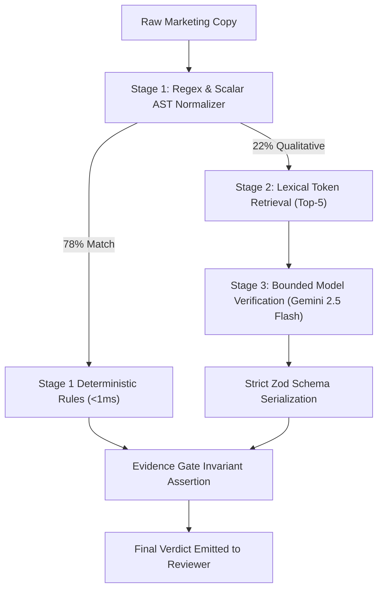

import { Callout } from 'fumadocs-ui/components/callout';
import { Card, Cards } from 'fumadocs-ui/components/card';
import { Tab, Tabs } from 'fumadocs-ui/components/tabs';
import { DeterministicRoutingBento } from '@/components/landing/bento/DeterministicRoutingBento';

Proofline is architected around a core engineering theorem: **never invoke a non-deterministic language model for a claim that can be verified with algebraic certainty.**

## The 78/22 Deterministic Split

Empirical evaluation across real enterprise marketing and release collateral demonstrates that **78% of checkable claims** revolve around concrete scalars:
- Currency and pricing tiers (`₹4,999/mo`, `$49/seat/yr`)
- Quantities and seat limits (`up to 25 seats`, `5 workspaces`)
- Temporal validity windows (`effective fiscal Q2`, `valid through Dec 2026`)
- Mandatory regulatory clauses (`Prices exclude applicable GST`)

Only the remaining **22%**—subjective architectural assertions and descriptive product capabilities—require semantic model reasoning.

  <DeterministicRoutingBento />

## The 3-Stage Resolution Pipeline

### Stage 1: TypeScript Scalar Fast-Path
Executes in under `0.4ms`. The segmenter splits draft sentences into candidate predicates and normalizes currency values (`parseInrScalar`), seat counts, and ISO dates. Findings are resolved against the in-memory fact register with zero external network overhead.

### Stage 2: Lexical Token Retrieval
For claims requiring semantic context, Stage 2 scores active registered facts by token overlap (BM25 tokenization). Exactly **≤5 candidate facts** are passed down to prevent context dilution.

### Stage 3: Bounded Model Tier
When a model call is unavoidable, the language model is strictly bounded:
1. It is provided only the draft claim and the 5 candidate facts.
2. It returns a strict Zod-validated JSON object containing only `matched_fact_id` and boolean agreement.
3. The model **never writes citations or character spans**. All spans are resolved in code.

<Callout type="warn" title="Model Isolation Rule">
If a model hallucinates a fact ID outside the provided top-5 set, the parser automatically intercepts the output and falls back to `UNVERIFIED`.
</Callout>
